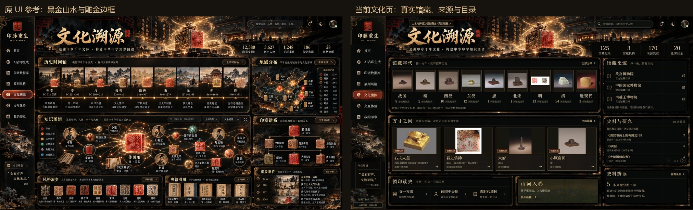
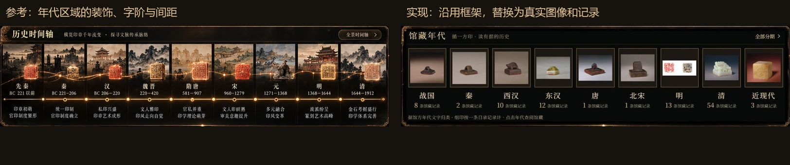

# 文化溯源页风格修正 · 2026-10-24

final result: passed

本轮仅验收 `/culture` 的黑金风格修正、当前桌面与手机排版以及相关导航。此结果不代表原八页严格像素复刻、全部页面视觉统一或整个项目验收通过。上一轮整体审美检查保留为 [历史检查](docs/design-qa-scroll-20261023.md)，其中尚未处理的跨页问题仍适用。用户本轮明确指出绿色资料面板与黑金外框不匹配；设计基准恢复为原有黑金山水 UI。

## 来源、状态与对照

- 视觉基准：`E:/LH1/图像/ChatGPT 图像 2026年10月21日 15_40_10-5.png`，1672×941；副本 `evidence/culture-style-20261024/reference-culture.png`。
- 用户反馈前状态：`evidence/culture-style-20261024/user-before.png`，1110×755，含浏览器顶部；用于确认绿色面板问题，未用于逐像素相似率。
- 实现：`http://127.0.0.1:5173/culture`，本机实值模式、资料加载完成、文献第 1 页、弹窗关闭。
- 桌面 CSS 1620×911；截图原件 `desktop-final.png` 为 2051×1153，其中网页实际绘制在左上 1620×911；只去除工具附加的外部画布得到 `culture-page.png`。
- 桌面两图按相同长宽比缩为 1000×563，并置于同一幅 `style-comparison.jpg` 中实际打开对照；局部 `focused-comparison.jpg` 将年代区并排对照字阶、间距、边框与图片处理。
- 手机 CSS 388×844、页面宽 388、内容高 2858；修正后截图 `mobile-fixed-full.png`，布局数值 `mobile-layout-fixed.json`。此截图已打开查看，临时视窗覆盖已恢复。

参考图中的地图、谱系、人物、数值及年代叙述不是本机已核实资料。因此只沿用其横幅、框架、字形和色彩，内容分别改为有出处的年代目录、真实馆藏、来源与研究目录。不以这类必要的内容差异声称“像素一致”。

## 发现、修正与复查历史

1. **P1：绿色资料面板与原外框脱节。** 用户截图中为整块墨绿底、通用小字、规则表格。已采用原 `culture-hero.png`、7 张原始雕金面板框、共享 MuseumSong 字体和黑金展签；沿用原设计主要区域位置。完整对照中已消除该风格断层。
2. **P2：初版桌面面板文字裁切。** `desktop-02-loaded.png` 及 DOM 测量显示年代、来源、馆藏、文献面板分别超出约 6、26、20、7 像素。调整标题行高、图片高度、上下内距后，`desktop-layout-final.json` 的 7 个面板均为 scrollHeight=clientHeight；最终截图可见底部来源、展签和翻页按钮。
3. **P1：手机横幅样式误作用于整个容器。** 中间版本 `mobile-final-full.png` 是失败证据，不是交付截图。Vue scoped 的局部全局选择器编译后将整页高度设为 110px，造成面板挤压。已将规则移到共享样式并限定为 `.im-page-culture .im-page-content>.hc-hero`，面板设为不收缩。修正后 `mobile-fixed-full.png`、`mobile-layout-fixed.json` 显示横幅约 110px，各面板按内容展开，页面 scrollWidth=388，分期弹窗可打开并关闭。
4. **P2：手机来源标记被侧栏挡住。** 已调整文化页标记左侧留白并改为黑金配色，修正截图中完整显示。
5. 文献不再将 20 条著录挤进一个小区域；每页 3 条、共 7 页。浏览器实际翻至第 7 页的 2 条著录，下一页禁用；原本的全文未核读状态明确保留。

## 五项视觉检查

| 检查面 | 结论 |
|---|---|
| 字体与字阶 | 使用既有 MuseumSong，与侧栏一致；23px 分区标题、17–19px 馆藏与年代标题、12–15px 元数据。手机独立字阶，真实长年代在卡片截断，可进入详情查阅。 |
| 间距与布局 | 桌面恢复横幅、年代区、来源区及下方多面板的原框架比例；7 个面板复查无内容裁切。手机按内容纵向重排，不压缩整块桌面画布。 |
| 色彩与令牌 | 面板为黑色与暖棕，标题与细边为金色，交互与实录标签为朱砂色；去除绿色正文面板与通用绿色表格。 |
| 图像质量 | 横幅及雕金框复用参考资产。馆藏照片与钤本保留官方原图比例、背景和颜色，未生成“更像参考”的假文物。年代缩略图均能加载。原始图片背景差异作为可接受的真实资料属性。 |
| 文案与内容 | 数据来自现有真实持久化与来源记录；125/3/170/20 不替换为参考假数值。5 条分期差异保留；文献明确仅核对著录；装饰性横幅印章与馆藏照片作出区分。 |

## 实际交互和运行检查

- 全部分期弹窗：桌面可打开、Escape 关闭；手机可打开并用关闭按钮关闭。使用原生 dialog 提供键盘焦点约束。
- 从分期弹窗点击“秦”，实际进入目录，时代筛选已选秦。
- 文献第一页、第二页、第七页可达；首尾页按钮禁用正确。结果见 `interaction-checks.json`。
- 从“右夫人玺”馆藏卡实际进入知识宇宙；选中标题为“右夫人玺篆文 · 馆藏实物记录”，见 `object-navigation.txt`。
- 本次文化页控制台警告/错误记录为空，见 `interaction-checks.json`。
- 生产构建通过，见 `build-final.txt`；文化页按需加载，馆藏注册表分块，主入口约 815KB、文化页逻辑约 9.55KB。
- 27 项既有前端数据与布局检查通过，见 `frontend-tests.txt`。未为这次可逆样式变更增加镜像实现的单元测试；后端代码和真实数据没有因本轮风格修改而变更。
- 服务曾在会话环境刷新时退出，已通过既有启动器恢复；MySQL、API 8001、Web 5173 均已恢复监听。

## 保留的范围与后续项

本轮解决文化页已反馈的风格错位。知识宇宙、真实目录与其他页面的跨页统一、较高桌面窗口的固定画布利用、完整无障碍、多设备及 VR 验收，仍属于原整体审美检查的未完成项。图片背景可在后续统一展签和留白，不更改文物本身。没有计算或宣称虚假的像素相似率。

实施清单：恢复原视觉资产；真实资料替换；文献分页；年代入口；修复桌面裁切；修复手机高度回归；截图对照；构建和既有检查。以上本轮条目均完成。
