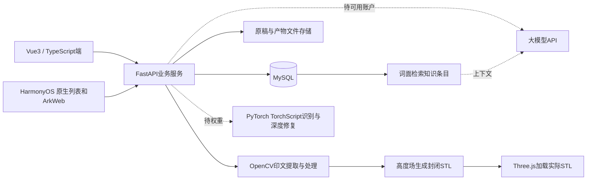

# 印脉重生系统架构与算法

## 数据流

Web真实请求后端，核心业务记录持久化在MySQL。图像和STL二进制保存在文件存储，MySQL保存归属、类型、参数、来源、SHA256和审计事件。这是本机部署的端与服务闭环；尚未部署华为云，不把本机服务称为已上线云环境。

## 数据表

| 表 | 核心内容 |
|---|---|
| seals | 印谱ID、名称、原始文件名、原稿SHA256、来源类别、UTC创建时间 |
| artifacts | 不可变版本ID、印谱外键、类型、文件、JSON元数据、UTC时间 |
| events | 操作类型、关联印谱、来源参数、人工校订/制作记录、问答记录 |
| knowledge | 实际知识正文、分类、来源标题、来源URL、示意配图 |

文件仅通过数据库中的不可预测ID读取，客户端不能提交任意服务器路径。上传文件名仅作展示，不用于拼接存储路径。每个处理版本验证来源属于同一印谱。原稿的上传字节保留；处理解码另行执行EXIF方向归一化、RGB转换和最长边2048缩放。`schema.sql`是本次代码定义的MySQL建表结构。初始开发使用自动建表，正式版本需引入迁移与备份。

业务列表暂有300条限制，时间线有200条限制；首页印谱/产物计数使用数据库聚合。模型统计目前根据返回列表计算，超过列表上限后需要服务端分页和聚合；不是大规模档案库成品。

## OpenCV处理

红色像素首先按HSV范围提取；未检测到足量红色时使用灰度反阈值和Otsu。手动阈值优先采用灰度阈值。去噪移除小连通区域；修复使用小椭圆核的形态学闭运算连接附近印迹。水平镜像作为明确参数保存。

这些是确定性处理，元数据固定写入 `ai_inference: false`。它们不能恢复失传篆字、不能自动断代，也不能保证残损笔画正确。当前没有多印章自动目标检测、透视校正、交互式ROI或矢量轮廓平滑。复杂古籍页应先裁切为单印图再上传。UI已避免把未完成检测说成可用AI能力。

## 三维算法

将印迹掩膜取样为24至128的方形网格。每个网格点建立顶部顶点和底面顶点，顶部、底面及周边逐一连成三角形；共享顶点保证边界闭合。

- 朱文：前景印迹高于基底。
- 白文：前景印迹为凹入区，非前景区保留较高表面。
- 镜像：在生成高度场前水平翻转掩膜。未勾选时保留图像方向。
- 长宽：当前只支持方形印面，由用户给定毫米宽度，不从扫描DPI推断历史实体尺寸。
- 输出前检查闭合、法线绕序和正体积；失败则拒绝导出。
- STL导出后重新读取的闭合与尺寸检查已通过测试。STL本身没有单位，使用者需按毫米导入切片软件。

当前是真实参数化浮雕，轮廓有像素取样造成的阶梯，缺少最小线宽和材料可加工性自动评估。它不生成参考图中的狮钮，不等于文物原器三维复原。最小线宽、刀具半径、支撑、切片与实际盖印需要制造验证。

## 服务接口

| 方法与路径 | 行为 |
|---|---|
| GET /api/health | 实际MySQL连接、计数、AI配置状态 |
| POST /api/seals | 上传原稿并归档 |
| GET /api/seals 与 /api/seals/{id} | 实际档案和版本 |
| PATCH /api/seals/{id} | 保存项目名称 |
| POST /api/seals/{id}/process | OpenCV处理并建立新版本 |
| POST /api/seals/{id}/reconstruct | 建立、检查并保存STL |
| POST /api/seals/{id}/ai | 仅在真实TorchScript模型可用时推理 |
| POST /api/seals/{id}/records | 保存人工确认和制造记录 |
| GET /api/files/{id} | 读取真实版本文件 |
| GET /api/events | 读取持久化审计记录 |
| GET /api/knowledge | 数据库词面查询 |
| POST /api/chat | 真实大模型调用与来源记录；未配置时503 |

详细请求格式见正在运行的 `/docs`。目前处理在FastAPI工作线程内同步执行，尚无异步任务队列；生产还需用户鉴权、权限分离、并发限制与备份恢复。
