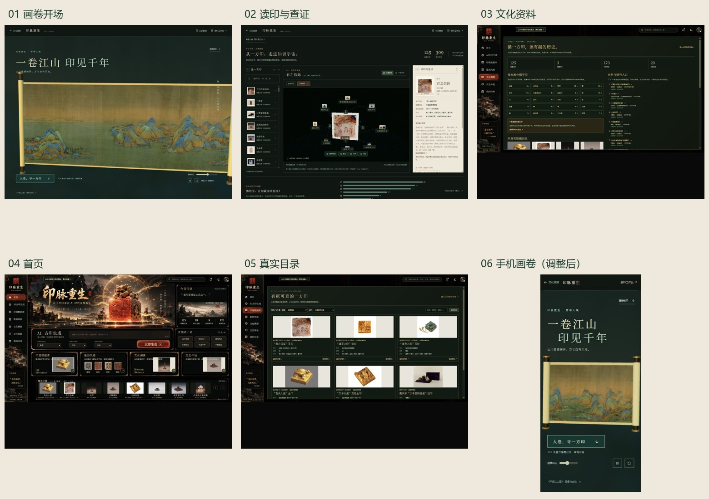

# 整体审美与布局自检 · 2026-10-23

> 2026-10-24补充：用户明确反馈文化页墨绿资料面板与原黑金外框不匹配。本项目本轮改以原黑金山水UI为文化页基准，已恢复横幅、雕金框与宋体，并保留真实数据；最新范围和截图见[文化页修正验收](../design-qa.md)。下文“以墨绿、绢白统一”的建议为上一轮意见，不再作为当前文化页的执行方向。其他未解决布局与跨页问题仍待处理。

结论：文化方向合理，视觉系统尚未统一；长卷已能展开，但展开后的叙事仍偏平，距离“山水浮现、古印成为主角”的目标还有差距。此次审阅完成，不把实现动画等同于设计已经通过。

审阅范围为当前实际运行的画卷入口、读印、文化页、首页、目录和手机画卷。使用本轮新截图，未拿旧参考图或早期开发截图充当现状。其他业务页、VR头显和整套无障碍合规没有覆盖。

## 按实际页面检查

1. **画卷入口：方向成立，表现力仍不足。** 青绿山水、宋体和墨绿背景适合文博内容，入口、暂停和跳过可找到。当前仍以平面长卷为主体，缺少“开卷→山川细节→一方真印”的连续主次转换。画面大片绢底与较亮的装裱压过部分青绿山体；应调整镜头取景和装裱，不能为追求鲜艳而伪造原画。证据：`audit-01-entrance.png`；修正比例后的`audit-08-entrance-postfix.png`。
2. **读印：三栏逻辑合理，阅读密度偏高。** 左选印、中探索、右查证符合任务顺序。主印相对画布偏小，部分汉字标签和关系线靠近图片、互相遮挡；底部说明和右栏小字偏弱。需要先放大主印、控制关联密度，再处理标签避让和阅读对比度。真实照片背景各异，宜统一展签边距与底托，不能裁掉来源信息或生成假文物替换。证据：`audit-02-reading-direct.png`。
3. **文化页：资料可信、结构清楚，视觉仍像资料后台。** 分期、差异和论著的分组有用；固定画布缩放使内容挤在上部，在1456×1118窗口下，下方仍闲置一片空间，面板内部却需要滚动。左侧浓重的山水装饰与右侧克制的资料区并未统一。证据：`audit-03-culture.png`。
4. **首页：品牌辨识强，重点过多。** 主视觉、金边、红色生成按钮、四张功能卡和八张精选同时争夺注意力；真实馆藏小图放进浓重的概念插画框架后显得局促。它偏游戏展台，而新画卷与读印偏文博研读。若沿新方向统一，应减少装饰层级，保留一处主视觉与一个主要入口。证据：`audit-04-home.png`。
5. **真实目录：检索网格可用，字号和视窗利用需改。** 三列卡片便于扫视，来源与文物号区分清楚；正文、元数据和筛选控件在缩放后偏小，固定高度与内部滚动延续了文化页的问题。建议用正常响应式内容流，完整图像配稳定的图像区域，避免把整个1672×941画布一同缩小。证据：`audit-05-catalog.png`。
6. **手机画卷：主次较桌面清楚，细节需继续控制。** 实测CSS388×844、scrollWidth388；主标题、画卷和进入按钮顺序明确。复查时已下移卷轴以避开副文案，隐藏压在画上的竖排文字，增加播放器按钮和游标的触控区域。仍需在不同手机和系统字体上检查，不能据单一浏览器称为全面适配。证据：修正前`audit-06-mobile.png`、修正后`audit-09-mobile-postfix.png`。

## 需要优先处理的三件事

| 优先级 | 问题 | 具体方向 |
|---|---|---|
| P1 | 跨页视觉语言分裂 | 以墨绿、绢白、朱砂为主，金色只作少量强调；统一字阶、边框、图片展签和按钮，不在同一层叠加多种装饰。 |
| P2 | 工作区小字与固定画布缩放 | 提高元数据、正文和控件的有效字号，优先保证阅读；内容随视窗重排，减少面板内部滚动和闲置黑区。 |
| P2 | 画卷与印章主次转换不足 | 长卷承担入场，随后把视线交给真实印章；先做镜头与信息层级，减少同时运动的粒子、纹样和标签。 |

## 本轮已修正与仍未修正

已经修正：画卷按画布宽高计算展开宽度，改善较高桌面窗口中的右轴裁切；手机卷轴与副文案避让；暂停状态文字；播放器触控尺寸；官方条目深链直接进入读印，保留可选的画卷入口。新截图确认手机无横向溢出，桌面/手机卷轴均可完整呈现。模型装裱亮度做了收敛，原画材质内容保留。

尚未修正：跨页整套视觉统一、首页信息层级、资料页固定画布、图谱标签避让和整体字阶。这些涉及原八页严格复刻与新画卷方向的取舍，本次不把它们偷偷改成另一套网站，也不把当前状态评价为成熟定稿。

## 可访问性和证据限制

暂停、重播、跳过、游标与来源按钮具有可读名称；直接读印会转移焦点。手机触控尺寸已调整。低对比小字仍是可见风险。减少动态效果和WebGL失败回退有实现，但本轮未通过模拟系统偏好、强制GPU丢失或多设备验证，不宣称完整无障碍合规。

截图原件在 `evidence/scroll-unfold-20261023/`；本轮桌面1456×1118，复查1455×1117（工具缩放取整相差1像素），手机388×844。截图接口附带的右侧/底部棕色画布不作为网页留白；总览只截取DOM实测的网页范围，原件保留。资料页范围内实际存在的黑色闲置区域仍保留。`audit-02-reading.png`捕获时存在滚动取景差异，已排除，改用从条目深链打开的稳定画面。

总览用于比较层级，具体字体和图像质量以原尺寸截图为准。本报告是当前页面的体验和视觉检查，不是对文物的专家鉴定，也不是原八页像素一致性验收。

建议下一轮先统一视觉规范和响应式布局，再继续增加山水叙事动效。
